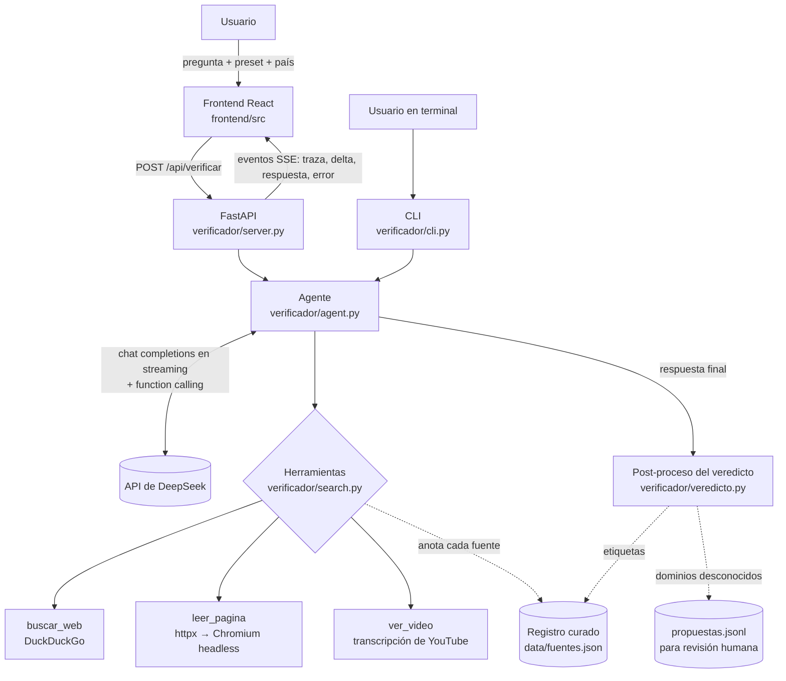

# Faro — verificador político con IA

**Faro** es un agente que verifica
afirmaciones políticas de cualquier país. Le escribís algo que escuchaste
—una frase de un candidato, una cifra que circula, un titular— y Faro busca
en la web, abre las fuentes, contrasta medios de distintas tendencias y
devuelve un veredicto (verdadero, falso, engañoso, sacado de contexto…) con
citas numeradas, los extractos que leyó y una medida de **solidez de la
evidencia** que calcula el propio programa, no el modelo.

Tiene una interfaz web (React) y una interfaz de terminal (CLI). El “cerebro”
es un modelo de [DeepSeek](https://api-docs.deepseek.com/) con herramientas
propias de búsqueda y lectura.

> El repositorio se llama `Verificador-Politico-` porque ese fue el nombre
> original del proyecto; luego pasó a llamarse Tomás y finalmente Faro.

---

## La idea

Un chatbot genérico responde de memoria, con fecha de corte y sin decir de
dónde sale cada dato. Para política eso no sirve: los hechos cambian rápido,
las citas se recortan y un mismo cable de agencia replicado por cinco medios
parece cinco confirmaciones.

Faro intenta aplicar la metodología de un verificador profesional:

1. **Ubicar la jurisdicción** (de qué país trata) y adaptar a ella qué medios y
   verificadores consultar.
2. **Buscar siempre** antes de responder y **contrastar** medios de derecha,
   izquierda y centro, priorizando verificadores de la red IFCN (Chequeado,
   Maldita, PolitiFact…).
3. **Contar confirmaciones independientes, no ecos.**
4. **Ir a la fuente primaria** (la declaración completa, la ley, el vídeo).
5. **No inventar**: si no consigue evidencia que pueda abrir y citar, lo dice.

Y además no confiar ciegamente en el modelo: el veredicto que devuelve se valida,
las etiquetas de las fuentes conocidas las pone un **registro curado a mano** y
la confianza se **recalcula** a partir de las fuentes realmente leídas.

Principios de diseño visibles en el código:

- **Sin memoria entre consultas.** Cada pregunta arranca de cero; no hay
  perfiles ni base de datos de usuarios. El hilo de la interfaz vive solo en la
  memoria del navegador.
- **Neutralidad.** El prompt prohíbe sugerir a quién votar y obliga a citar
  cada dato.
- **El contenido web es evidencia, no instrucciones.** Todo lo que devuelven
  las herramientas se envuelve como “evidencia web no confiable” para mitigar
  inyección de prompts.

---

## Cómo funciona



### Recorrido de una consulta

1. **Entrada.** La web manda `pregunta`, `pais` (opcional, ISO de 2 letras),
   `rigor`, `largo` y `detalle`. El servidor valida (máx. 4000 caracteres),
   limita a 4 verificaciones simultáneas y corta a los 120 s. Si el navegador
   se desconecta, la consulta se cancela.
2. **Mensajes iniciales.** El agente arma el prompt de sistema (toda la
   metodología vive en `verificador/prompts.py`), la fecha de hoy, el país si
   se fijó y una instrucción de “modo de respuesta” (largo × nivel de detalle).
3. **Bucle de investigación.** Hasta 8 vueltas (4 en modo `rapido`). En cada
   vuelta el modelo responde en streaming; si pide herramientas, se ejecutan
   **en paralelo** (hasta 4 a la vez) y sus resultados vuelven al modelo:
   - `buscar_web`: DuckDuckGo vía `ddgs`, sin API key, con región según el
     país, hasta 8 resultados (4 en modo rápido) y 3 reintentos.
   - `leer_pagina`: caché de 15 min → descarga rápida con `httpx` +
     `trafilatura` → si falla, Chromium headless con Playwright (para sitios
     con JavaScript o bloqueos). Cada URL y cada redirección pasa por un
     guardia anti-SSRF que solo admite hosts públicos.
   - `ver_video`: transcripción de YouTube/Shorts (`youtube-transcript-api`).
     Verifica lo que se *dice*, no la imagen.

   Cada resultado llega anotado con la ficha del registro curado (“fiabilidad
   ALTA · manipulación NINGUNA · tendencia centro”) o con un aviso de dominio no
   registrado.
4. **Respuesta final.** Cuando el modelo deja de pedir herramientas, su texto
   (prosa con citas `[n]` + un bloque ```` ```json ```` de cierre) pasa por
   `veredicto.procesar()`, que **nunca lanza**:
   - separa la prosa del JSON y, si el JSON falta, pide **una** reparación;
   - valida campo a campo (lo inválido se descarta, no todo el bloque);
   - marca qué fuentes se citan realmente en el texto;
   - para dominios del registro, **las etiquetas del registro mandan** sobre las
     del modelo;
   - adjunta a cada fuente el extracto leído durante la investigación;
   - **recalcula la confianza** (la del modelo queda como `confianza_modelo`);
   - si no se leyó ninguna fuente, degrada el veredicto a `sin_evidencia`.
5. **Propuestas.** Los dominios citados que no están en el registro se anotan
   en `verificador/data/propuestas.jsonl` (ignorado por git) para que una
   persona decida si los agrega al registro.

### Veredictos posibles

`verdadero` · `falso` · `enganoso` · `fuera_de_contexto` · `prediccion` ·
`sin_evidencia` · `informativo` (preguntas que no son una afirmación) ·
`no_verificable` (opiniones, saludos, etc.: no se investigan).

### Cómo se calcula la “solidez de la evidencia”

En `veredicto.calcular_confianza()`. Solo cuentan fuentes **abiertas, citadas y
de dominios distintos**:

- cada fuente que respalda suma según su credibilidad (alta 1 · media 0,6 ·
  baja 0,25 · no fiable 0); las que no están en el registro curado tienen tope
  0,6;
- si respaldan fuentes de tendencias opuestas (o un verificador más otra
  fuente), hay un bono de contraste (×1,25);
- las fuentes marcadas como engañosas o desinformadoras nunca suman y, si
  “respaldan”, restan; las que matizan restan un poco;
- la curva es asintótica: `95 · (1 − e^(−0,7·peso))`, así que nunca llega a 100.

### Eventos SSE de `/api/verificar`

| Evento        | Dato                                   | Uso                                        |
|---------------|----------------------------------------|--------------------------------------------|
| `traza`       | `{id, tipo, estado, titulo, url, dominio, extracto?}` | cada búsqueda/lectura (inicio y fin)  |
| `delta`       | `{texto}`                              | fragmento de la respuesta en streaming     |
| `delta_reset` | `{}`                                   | descartar lo emitido (el modelo pidió tools) |
| `respuesta`   | `{texto}`                              | respuesta final completa (prosa + JSON)    |
| `error`       | `{mensaje}`                            | error ya saneado para el usuario           |

---

## Stack

| Capa        | Tecnología |
|-------------|------------|
| Modelo      | DeepSeek (`deepseek-v4-flash` por defecto) vía SDK `openai` (API compatible) |
| Backend     | Python 3.10+, FastAPI, uvicorn, SSE |
| Búsqueda    | `ddgs` (DuckDuckGo), `httpx`, `trafilatura`, Playwright + Chromium, `youtube-transcript-api` |
| Frontend    | React 19, TypeScript, Vite, CSS propio, `lucide-react`, fuente Geist |
| Calidad     | pytest, oxlint, `tsc`, tests de contrato en Node (`tests/*.mjs`) |

---

## Instalación

Requisitos: **Python 3.10+**, **Node.js 22+** y una **API key de DeepSeek**.

```bash
git clone https://github.com/nachapoticon-dot/Verificador-Politico-.git
cd Verificador-Politico-

# 1. Backend
python3 -m venv .venv
source .venv/bin/activate
pip install -r requirements.txt

# 2. (Opcional, recomendado) Chromium para leer sitios con JavaScript.
#    Sin esto, leer_pagina usa solo la descarga rápida con httpx.
playwright install chromium

# 3. Clave
cp .env.example .env
#    editá .env y poné tu DEEPSEEK_API_KEY

# 4. Frontend (el servidor sirve el build de frontend/dist)
cd frontend
npm install
npm run build
cd ..
```

## Uso

### Interfaz web

```bash
uvicorn verificador.server:app --reload
```

Abrí <http://127.0.0.1:8000>. Elegí un preset (**Esencial**, **Normal** o
**A fondo**), opcionalmente un país, y escribí la afirmación. Vas a ver en vivo
el recorrido de búsquedas y lecturas, y al final el veredicto, la solidez, el
resumen de evidencia y la lista de fuentes con su extracto. Podés detener una
verificación, reintentarla o copiar el análisis con sus referencias.

`GET /healthz` devuelve `{"ok": true, "config": <hay clave?>}`.

### Desarrollo del frontend con recarga automática

Con uvicorn corriendo en el puerto 8000:

```bash
cd frontend
npm run dev     # Vite en http://localhost:5173, con proxy de /api al 8000
```

### CLI

```bash
python main.py                                         # modo interactivo
python main.py "¿Es verdad que bajó la inflación?"      # pregunta única
python main.py --pais AR "¿Milei eliminó el Banco Central?"
```

En el modo interactivo: `/pais XX` fija el país, `/pais off` lo quita y
`/salir` termina. El CLI muestra la traza y luego la respuesta completa
(incluido el bloque JSON), siempre en modo riguroso y largo normal.

### Revisar dominios propuestos

```bash
python -m verificador.fuentes revisar
```

Lista los dominios no registrados que el modelo clasificó, en formato listo
para copiar a `verificador/data/fuentes.json` si los aprobás.

---

## Configuración

Variables de entorno (o archivo `.env` / `.env.local` en la raíz):

| Variable            | Obligatoria | Por defecto               | Descripción |
|---------------------|-------------|---------------------------|-------------|
| `DEEPSEEK_API_KEY`  | sí          | —                         | Clave de la API de DeepSeek |
| `DEEPSEEK_BASE_URL` | no          | `https://api.deepseek.com`| Endpoint compatible con OpenAI |
| `DEEPSEEK_MODEL`    | no          | `deepseek-v4-flash`       | También `deepseek-v4-pro` |
| `EDIFICIA_DIR`      | no          | `~/Proyectos/EdifcIA`     | Ver nota abajo |

Ejemplo de `.env`:

```dotenv
DEEPSEEK_API_KEY=sk-tu-clave-aqui
# DEEPSEEK_MODEL=deepseek-v4-pro
```

Orden de búsqueda de cada variable: entorno → `.env` → `.env.local` → como
último recurso, el `.env.local` de otro proyecto del autor (EdifcIA), para
reutilizar esa clave sin copiarla. Si no usás EdifcIA, ignoralo.

Constantes ajustables en el código (no son variables de entorno): pasos
máximos del agente (`agent.py`), concurrencia y timeout del servidor
(`server.py`), TTL y tamaño de la caché de lecturas (`search.py`).

---

## Estructura

```text
├── main.py                    Entrada del CLI
├── requirements.txt           Dependencias de Python (incluye pytest)
├── .env.example               Plantilla de configuración
├── verificador/
│   ├── agent.py               Bucle del agente: streaming, tools en paralelo, cancelación
│   ├── search.py              buscar_web / leer_pagina / ver_video, caché, guardia SSRF, Playwright
│   ├── veredicto.py           Contrato del JSON de cierre, citas, solidez calculada
│   ├── fuentes.py             Registro curado y captura de propuestas
│   ├── prompts.py             Metodología del agente y modos de respuesta
│   ├── urls.py                URL canónica (clave de caché y de extractos)
│   ├── config.py              Carga de la clave y del modelo
│   ├── server.py              API FastAPI + SSE; sirve frontend/dist
│   ├── cli.py                 Interfaz de terminal
│   └── data/fuentes.json      Registro curado (33 dominios)
├── frontend/
│   └── src/
│       ├── App.tsx            Layout, presets, selector de país, composer
│       ├── hooks/useVerificador.ts   Estado de los turnos y del streaming
│       ├── lib/               Cliente SSE, tipos, parseo de la respuesta, mapas de etiquetas
│       └── components/        Trace, Answer, Sources, RichText, avatares
└── tests/                     pytest (backend) + contratos en Node (format.ts, sse.ts)
```

---

## Pruebas

```bash
.venv/bin/python -m pytest -q        # backend: no llama a la API real
cd frontend && npm run check         # contratos SSE/format + oxlint + build
```

Ninguna prueba necesita una clave de DeepSeek ni red: el modelo y las
herramientas se sustituyen por dobles. El test de afinidad de hilo de
Playwright se salta si Chromium no está instalado.

---

## Estado actual

**Funciona** (cubierto por tests y comprobado localmente):

- Bucle completo del agente con streaming, herramientas en paralelo,
  cancelación y límite de pasos.
- Búsqueda, lectura con fallback a navegador, transcripciones de YouTube,
  caché y guardia anti-SSRF.
- Post-proceso del veredicto: validación, reparación, registro curado,
  extractos, solidez calculada y degradación a `sin_evidencia`.
- Servidor SSE con límites de concurrencia, tamaño y tiempo; interfaz web y CLI.

**Limitaciones conocidas**

- **Depende de DeepSeek.** Los nombres de modelo cambian (en julio de 2026 se
  retiró `deepseek-chat`); si la API rechaza el modelo, ajustá `DEEPSEEK_MODEL`.
- **La búsqueda es frágil.** `ddgs` raspa DuckDuckGo sin API oficial: puede
  devolver pocos resultados o bloquearse. Hay reintentos, no garantías.
- **No está listo para exponerse a internet.** No hay autenticación ni límite
  por usuario; solo un tope global de 4 consultas simultáneas. Pensado para uso
  local.
- **Sin contexto entre turnos.** Cada consulta es independiente: una pregunta
  de seguimiento (“¿y eso cuándo fue?”) no ve la anterior.
- **El registro curado es chico** (33 dominios, sobre todo de habla hispana y
  EE. UU.). Fuera de él, las etiquetas las pone el modelo y su peso en la
  solidez está acotado.
- El modo `rigor: "rapido"` existe en la API, pero ningún preset de la interfaz
  ni el CLI lo usa. El CLI tampoco permite elegir largo ni detalle.
- `propuestas.jsonl` se escribe dentro del paquete (`verificador/data/`); en un
  despliegue de solo lectura la captura falla en silencio.
- La calidad del veredicto depende de las fuentes que se puedan abrir; muchos
  medios con muro de pago o anti-bots quedan como “no abierta”.
- No hay integración continua configurada en `main`.

Existe una rama `faro-siguiente-nivel`, sin fusionar, con trabajo posterior
(tipos de consulta separados del veredicto, otra curva de solidez, prueba de
humo contra la API real, CI). Algunos de sus arreglos puntuales ya se trajeron a
`main`.


---

## Aviso

Faro es una herramienta de apoyo, no un árbitro infalible. Un registro editorial
por dominio es orientativo y una fuente leída puede tener errores; por eso Faro
muestra los extractos y enlaces, para que cualquiera pueda revisar la evidencia
por su cuenta.
